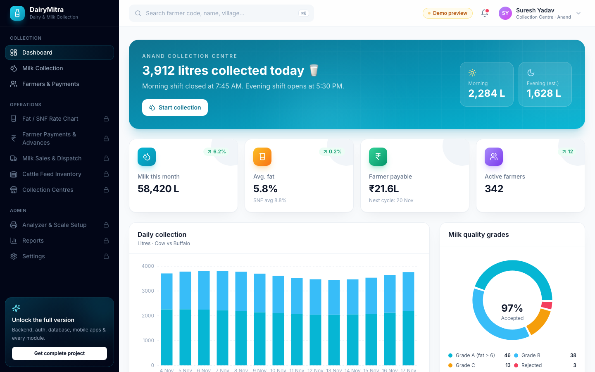
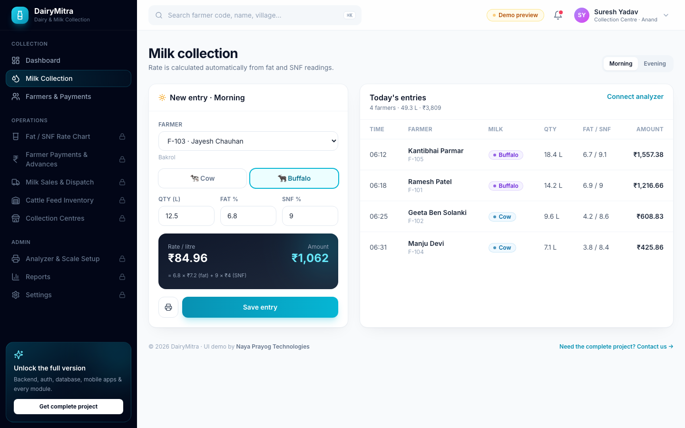
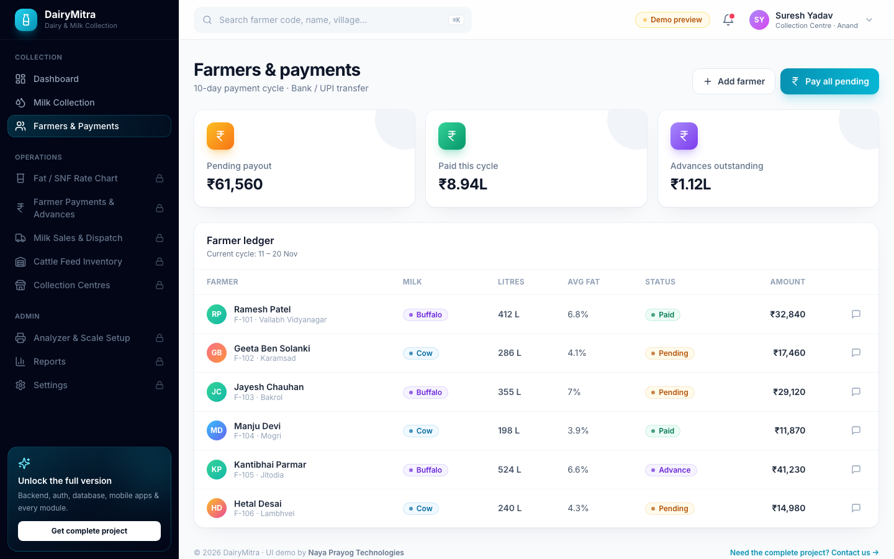

# Dairy Management Software | Milk Collection, Billing & Dairy ERP System

Simplify dairy operations with custom **Dairy Management Software** developed by **Naya Prayog Technologies**.

We provide dairy software development services for dairy farms, milk collection centers, dairy cooperatives, milk unions, milk distributors, and dairy processing businesses.

A modern dairy management system can help businesses manage daily milk collection, farmer records, milk quality, fat and SNF measurements, payment calculations, billing, inventory, and business reports through a centralized platform.

Whether you operate a small milk collection center or manage a large dairy business with multiple collection points, we can develop a solution tailored to your operational requirements.

**Looking for Dairy Management Software Development?**

Let's discuss your dairy business requirements.

- Website: https://nayaprayog.com/
- Email: support@nayaprayog.com
- Phone / WhatsApp: +91 7991327022
- Direct WhatsApp: https://wa.me/917991327022
- Portfolio: https://github.helloharendra.io

---

## What Is Dairy Management Software?

Dairy Management Software is a digital system designed to organize and automate the daily activities of dairy businesses.

It can connect milk producers, collection centers, dairy operators, distributors, and administrators through a centralized platform.

Common business operations include:

- Daily milk collection
- Farmer and supplier management
- Milk quantity recording
- Fat and SNF measurement records
- Milk rate calculation
- Farmer payment management
- Milk sales and distribution
- Dairy inventory management
- Billing and accounting records
- Business reports and analytics

The objective is to reduce manual record-keeping, improve calculation accuracy, and provide better visibility into dairy operations.

---

## Dairy Management Software Development Services

We develop custom dairy software solutions based on your business model, collection process, and operational requirements.

### 1. Milk Collection Management Software

Manage daily milk collection from farmers and milk suppliers.

Potential features:

- Farmer registration and profiles
- Daily milk collection entries
- Morning and evening collection
- Cow and buffalo milk categories
- Milk quantity recording
- Collection date and time
- Farmer-wise collection history
- Collection center management
- Daily collection summaries
- Collection reports

### 2. Milk Fat and SNF Management

Maintain milk quality measurements and support quality-based pricing workflows.

Potential features:

- Fat percentage recording
- SNF percentage recording
- Milk quality records
- Cow and buffalo milk differentiation
- Quality-based rate configuration
- Fat and SNF-based pricing calculations
- Farmer-wise quality history
- Quality reports
- Milk testing record management

Calculation formulas and rate charts can be configured according to the dairy's business rules.

### 3. Milk Billing and Rate Calculation

Organize milk collection billing and payment calculations.

Potential capabilities:

- Milk quantity-based calculations
- Fat-based rate calculations
- SNF-based rate calculations
- Configurable milk rate charts
- Farmer-wise billing
- Daily and periodic billing
- Advance and deduction records
- Payment statements
- Printable receipts
- Collection summaries

### 4. Farmer and Supplier Management

Maintain organized records for milk producers and suppliers.

Potential features:

- Farmer registration
- Farmer identification details
- Contact information
- Bank and payment details
- Milk supply history
- Collection records
- Quality history
- Payment history
- Outstanding balances
- Farmer-wise reports

### 5. Farmer Payment Management

Manage payments based on milk collection and configured pricing rules.

Potential features:

- Farmer-wise payment calculation
- Daily and periodic payment summaries
- Weekly and monthly settlement cycles
- Advance payments
- Deductions and adjustments
- Payment status tracking
- Bank and digital payment records
- Payment statements
- Pending payment reports

### 6. Dairy Inventory Management

Organize stock and inventory related to dairy business operations.

Potential capabilities:

- Product and item management
- Feed and cattle supply inventory
- Packaging material records
- Stock purchases
- Stock adjustments
- Supplier management
- Inventory movement
- Low-stock alerts
- Purchase reports

Inventory modules can be customized for the specific type of dairy business.

### 7. Milk Sales and Distribution Management

Manage milk sales and distribution operations.

Potential features:

- Milk product management
- Sales entry
- Customer management
- Retail and wholesale sales
- Distribution records
- Route and delivery management
- Sales billing
- Customer payment records
- Daily sales reports

### 8. Dairy Admin Dashboard

A centralized administration dashboard can help dairy owners monitor their business.

Potential capabilities:

- Farmer management
- Collection center management
- Milk collection monitoring
- Quality records
- Rate chart configuration
- Farmer payment monitoring
- Sales and purchase reports
- Staff management
- Financial summaries
- User roles and permissions
- Business analytics

---

## Core Modules of a Dairy Management System

| Module | Business Purpose |
|---|---|
| Farmer Management | Maintain milk producer information |
| Milk Collection | Record daily milk quantities |
| Fat and SNF Management | Maintain milk quality measurements |
| Rate Chart Management | Configure milk pricing rules |
| Billing System | Calculate collection and payment amounts |
| Payment Management | Track farmer settlements |
| Collection Center Management | Manage multiple milk collection points |
| Inventory Management | Track dairy-related stock |
| Milk Sales Management | Record milk sales and distribution |
| Supplier Management | Maintain supplier records |
| Reports and Analytics | Monitor dairy business performance |
| Staff Management | Manage users and access permissions |

Modules can be selected and customized according to the size and requirements of your dairy business.

---

## Types of Dairy Businesses We Support

| Business Type | Potential Software Requirements |
|---|---|
| Milk Collection Centers | Daily collection and farmer records |
| Dairy Farms | Milk production and operational management |
| Dairy Cooperatives | Farmer accounts and collection management |
| Milk Unions | Multiple collection center management |
| Milk Distributors | Sales and distribution management |
| Dairy Processing Units | Procurement and inventory workflows |
| Milk Retail Businesses | Billing and customer management |
| Multi-Branch Dairy Businesses | Centralized dairy operations |

---

## Benefits of Dairy Management Software

A well-designed dairy management system can help businesses:

- Reduce manual milk collection records
- Improve farmer account management
- Organize daily milk quantity entries
- Maintain fat and SNF measurement history
- Standardize milk rate calculations
- Improve payment transparency
- Monitor collection center performance
- Manage multiple collection points
- Organize milk sales and distribution
- Generate useful business reports

---

## Web, Desktop and Mobile Dairy Software

Depending on your business model, we can develop dairy software for different platforms.

**Web-Based Dairy Management Software**

Manage farmers, collection, billing, payments, and reports through a centralized web dashboard.

**Desktop Dairy Billing Software**

Develop counter-oriented software for milk collection centers and dairy offices, depending on hardware and deployment requirements.

**Mobile Dairy Management App**

Provide mobile access to selected workflows for farmers, collection operators, and dairy administrators.

**Multi-Collection Center Software**

Connect multiple milk collection points to a centralized management system.

**Offline-Capable Collection Workflows**

Where required, selected collection workflows can be designed to operate during temporary connectivity interruptions, with synchronization rules defined during development.

---

## Why Choose Naya Prayog Technologies?

**Custom Dairy Software Development**

We develop solutions based on your dairy's actual collection, pricing, billing, and payment workflows.

**Business-Oriented Architecture**

We plan modules around daily dairy operations and the requirements of different user roles.

**Multi-Platform Development**

Solutions can include web applications, desktop-oriented systems, and Android or iOS applications.

**Scalable Solutions**

Build a system that can support additional farmers, users, collection centers, and business locations as requirements grow.

**Integration Capabilities**

Integrate supported weighing scales, milk analyzers, printers, payment services, and third-party APIs where technically feasible.

**End-to-End Development**

We can assist with requirement analysis, UI/UX design, application development, testing, deployment, and ongoing maintenance.

---

## Technology Stack

Technology selection depends on project requirements and deployment architecture.

Potential technologies include:

- **Mobile Applications:** Flutter, Android, iOS
- **Frontend:** React, Next.js
- **Backend:** Node.js, REST APIs
- **Database:** MySQL, PostgreSQL, MongoDB, Firebase
- **Cloud and Deployment:** VPS and cloud infrastructure
- **Integrations:** Milk analyzers, weighing equipment, printers, payment gateways, and third-party APIs

---

## Data Security and Business Records

Dairy management applications may contain farmer information, financial records, supplier details, and business-sensitive data.

Depending on the application scope, development may include:

- Secure user authentication
- Role-based access control
- Protected API endpoints
- Secure data transmission
- Farmer and supplier record permissions
- Payment and transaction history
- Audit logs
- Backup and recovery planning
- Controlled access to business reports

Security requirements should be assessed according to the application architecture and business environment.

---

## Dairy Management Software Development Process

1. **Business Analysis** – Understand your dairy operations, milk collection process, farmer network, and payment cycles.
2. **Module Planning** – Define collection, quality, rate calculation, billing, and payment modules.
3. **UI/UX Design** – Design practical interfaces for collection operators, dairy owners, and administrators.
4. **Software Development** – Develop the applications, backend APIs, database, and administration dashboard.
5. **Hardware Integration** – Integrate supported milk analyzers, weighing equipment, printers, and other devices.
6. **Testing and Quality Assurance** – Validate collection entries, calculations, payments, and reports.
7. **Deployment** – Deploy and configure the agreed solution.
8. **Maintenance and Enhancement** – Support future improvements and business expansion as agreed.

---

## Frequently Asked Questions

### What is dairy management software?

Dairy management software is a digital business application used to manage milk collection, farmer records, milk quality, pricing, billing, payments, inventory, and dairy operations.

### Can you develop milk collection software?

Yes. We can develop software for daily milk collection, farmer management, quantity recording, collection history, and collection center operations.

### Can the software calculate milk rates based on fat and SNF?

Yes. Configurable fat and SNF-based pricing workflows can be developed according to your dairy's rate charts and business calculation rules.

### Can you develop software for multiple milk collection centers?

Yes. A centralized system can support multiple collection centers, with center-wise collection records and consolidated reporting.

### Can farmers access their milk collection and payment details?

Yes. A farmer-facing mobile application or portal can be developed to display collection history, quality measurements, and payment statements, subject to the agreed scope.

### Can you integrate milk analyzers and weighing machines?

Supported equipment can be integrated after checking device specifications, connectivity methods, communication protocols, and compatibility.

### Can dairy software work without an internet connection?

Offline-capable workflows can be developed for selected operations. The offline data storage and synchronization approach must be planned according to the required devices and infrastructure.

### How much does dairy management software development cost?

The cost depends on the number of modules, user roles, collection centers, hardware integrations, platforms, and deployment requirements. Contact us to discuss your project and receive an estimate.

---

## Build Your Custom Dairy Management System

Looking for milk collection software, dairy billing software, farmer payment management, or a complete dairy ERP solution?

**Naya Prayog Technologies** helps dairy businesses develop custom software solutions that simplify operations and support business growth.

**Discuss Your Dairy Software Project**

- Website: https://nayaprayog.com/
- Email: support@nayaprayog.com
- Phone / WhatsApp: +91 7991327022
- Direct WhatsApp: https://wa.me/917991327022
- Portfolio: https://github.helloharendra.io

**Naya Prayog Technologies**  
Custom Software Development | ERP Solutions | Billing Software | Business Automation

---

## Repository Information

This repository is a service and portfolio showcase for dairy management software development by Naya Prayog Technologies.

The features described above represent potential development capabilities and solution modules. They should not be interpreted as confirmation that every feature is implemented in a ready-to-use application.

**Proprietary Notice:** This repository is a project showcase. No permission to redistribute, reuse, or commercially exploit proprietary source code, branding, or materials is granted unless separately authorized in writing.

<!-- screenshots -->
## Screenshots

**Dashboard**

<table>
  <tr>
    <td align="center" width="50%"><b>Collection</b>  </td>
    <td align="center" width="50%"><b>Farmers</b>  </td>
  </tr>
</table>
